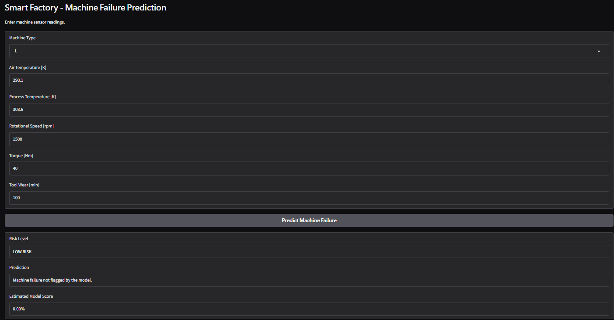

# 🏭 Smart Factory – Machine Failure Early-Warning System

## 📌 Project Overview
This project uses Machine Learning to identify potential machine failures based on sensor readings. It aims to demonstrate predictive maintenance using a Random Forest classifier.

## 🎯 Objective
To predict whether a machine may experience failure using operational sensor data.

## 📊 Dataset
- **Name:** AI4I 2020 Predictive Maintenance Dataset
- **Source:** [UCI Machine Learning Repository](https://archive.ics.uci.edu/dataset/601/ai4i+2020+predictive+maintenance+dataset)
- **Records:** 10,000
- **Target:** Machine Failure

## 🛠️ Technologies Used
- Python
- Pandas & NumPy
- Matplotlib & Seaborn
- Scikit-learn
- Gradio

## 🤖 Machine Learning
- Algorithm: Random Forest Classifier
- Class imbalance handling: Balanced class weights
- Threshold selection: Validation-based

## 📈 Model Evaluation
Failure class results on the evaluation dataset:
- Precision: 0.73
- Recall: 0.68
- F1-score: 0.70

## ✨ Project Features
- Data cleaning and preprocessing
- Exploratory Data Analysis (EDA)
- Machine failure prediction
- Low, Medium and High risk classification
- Interactive Gradio dashboard
- Feature importance visualization

## 📂 Project Files
- `Smart_Factory.ipynb` – Complete ML workflow
- `requirements.txt` – Required Python libraries
- `README.md` – Project documentation

## ⚠️ Disclaimer
This is an educational prototype using a synthetic dataset. It is not validated for real industrial use or safety-critical decisions.
## Dashboard Preview

